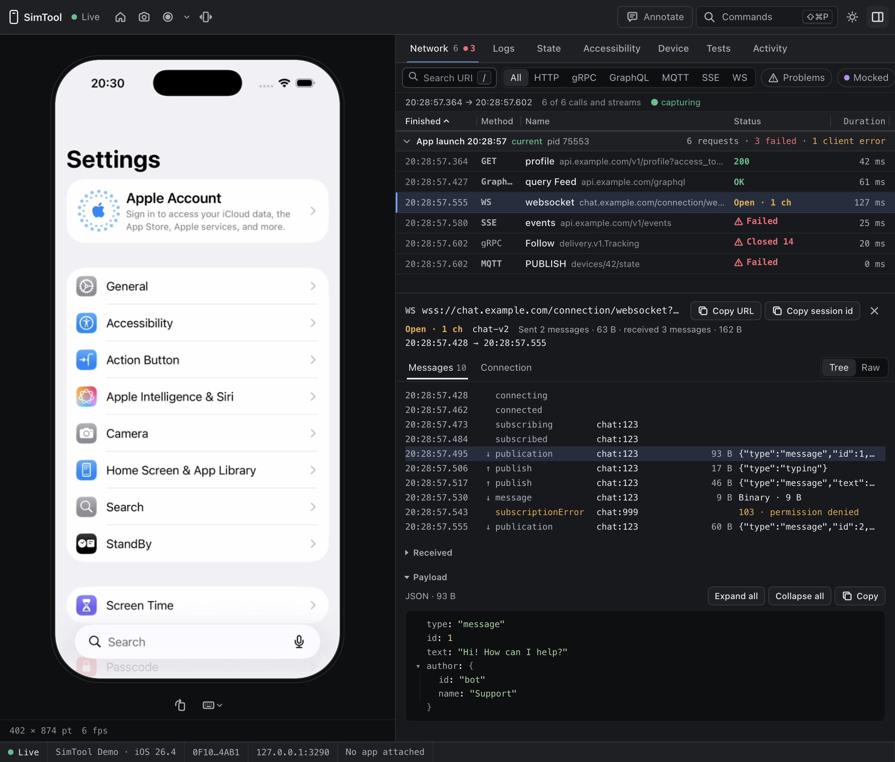

# SimTool

Stream, drive and inspect iOS Simulators from a browser, a terminal or an AI
agent.



SimTool runs a local server beside a simulator and gives you:

- **A browser viewer** — the live screen with touch, keyboard, rotation,
  screenshots and recordings, and an inspector beside it: **Network**, **Logs**,
  **State**, **Accessibility**, **Device**, **Tests** and **Activity**.
- **A CLI for agents and scripts** — every action with `--json`: taps and
  gestures, the accessibility tree, logs, network, device settings, app build
  and launch.
- **YAML tests** — steps that wait for the accessibility tree instead of
  sleeping, each run recorded with its video, network, logs and state per step.
- **Libraries for your app** — `SimToolNetworkLogger` reports calls and streams
  of any protocol (HTTP, gRPC, WebSocket, …), and `SimToolStateLogger` streams
  `@Observable` model state. Both are for debug builds.
- **An HTTP API** — what the viewer and the CLI use, open to your own tools.

## Install

Apple silicon (arm64), macOS 14 or newer, Xcode with simulator runtimes.

```sh
brew tap platacard/simtool
brew trust platacard/simtool
brew install simtool
simtool doctor
```

Or pin the version per project with [mise](https://mise.jdx.dev):
`mise use github:platacard/SimTool@1.0.0`. Manual downloads, checksums and
prerequisites: [docs/install.md](docs/install.md).

## Quick start

In an app's repository:

```sh
simtool init        # .simtool/config.yml: simulator, app and build; offers the agent skills
simtool run --web   # build, install and launch the app, then open the viewer
```

Any simulator, without a project:

```sh
simtool devices --json
simtool serve --device "iPhone 17 Pro" --web
```

Then drive it from a terminal, a script or an agent:

```sh
simtool input tap --label Continue --json
simtool ax tree --flat --labeled
simtool logs tail --app com.example.MyApp --lines 20 --json
simtool test run .simtool/tests/login.yml
```

## In your app

Link the libraries in debug builds, pinned to the release of your CLI:

```swift
.package(url: "https://github.com/platacard/SimTool.git", exact: "1.0.0"),
```

```swift
import SimToolNetworkLogger

let logger = SimToolNetworkLogger.resolved()        // nil unless SimTool armed the app
logger?.instrument(URLSessionConfiguration.default) // URLSession traffic
let chat = logger?.startStream(.websocket, url: socketURL)
chat?.received(.text(json), channel: "chat:1")      // and any other protocol, call or stream
```

`simtool run` arms the loggers for the app it launches. See
[the network logger SDK](docs/network-logger.md) and
[the model state inspector](docs/state-inspector.md).

## Documentation

- [The viewer and the server](docs/usage.md) — the viewer, its tabs, the
  processes and simulators SimTool holds
- [Automation from the CLI](docs/automation.md) — input, accessibility, logs,
  network, settings
- [Tests and sessions](docs/tests.md) — YAML tests, verdicts, evidence, sharing
- [Building and launching apps](docs/app-build.md) — builds, caching, Xcode over
  MCP, launch arguments
- [The network logger SDK](docs/network-logger.md)
- [Model state inspector](docs/state-inspector.md)
- [Project config, `run` and `open`](docs/project-config.md)
- [HTTP API](docs/http-api.md)
- [Install](docs/install.md) and [releasing](docs/release-distribution.md)

## Build from source

Two SwiftPM packages: the root vends the app libraries, `Tool/` builds the CLI.

```sh
swift build --package-path Tool
swift run --package-path Tool simtool doctor
swift test && swift test --package-path Tool
```
